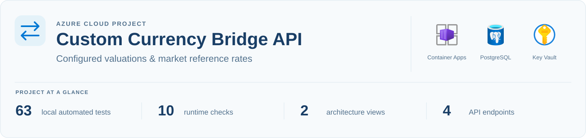
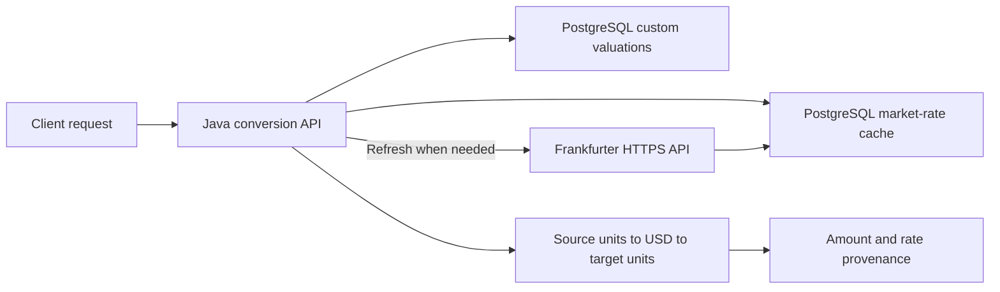
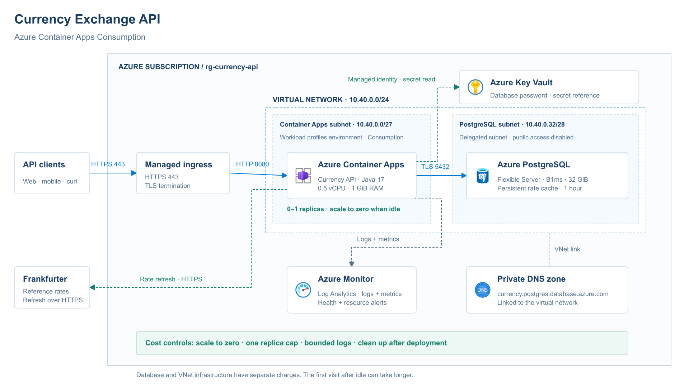
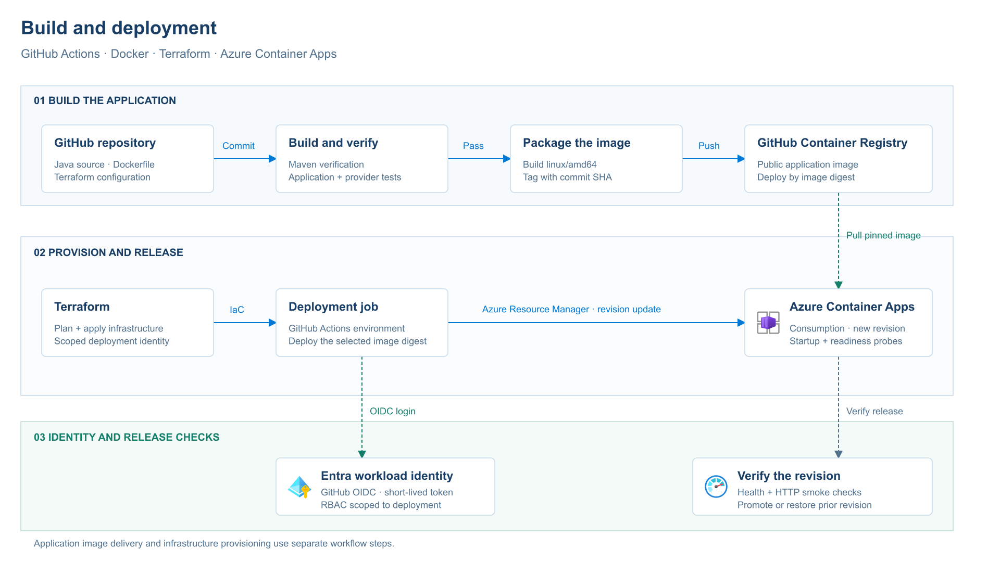

A Java REST API that converts locally managed and application-specific currencies into supported market currencies through USD. Visitors can add new custom valuations through the public form, and operators maintain existing rates in PostgreSQL; the API combines it with Frankfurter reference rates and shows where both rates came from.

**Explore:** [Project context](#project-context) · [Implementation](#implementation) · [Cloud architecture](#cloud-architecture) · [Build and deployment](#build-and-deployment) · [Results](#local-verification) · [Documentation](#documentation)

## Live demo

[Public documentation](https://docs.dhawr.com/) · [Example conversion](https://api.dhawr.com/api/convert?amount=1000&from=GAME_CREDITS&to=USD) · [Readiness](https://api.dhawr.com/actuator/health/readiness)

The current demo runs on the existing VPS behind aaPanel-managed Apache. This is separate from the Azure Terraform deployment, which remains untested in Azure. The API domain serves JSON; the documentation page lives on the docs domain.

The demo configures **500 fictional GAME_CREDITS per USD**, valid through **December 1, 2026**. This is an illustrative operator valuation, not a market quote. It must be updated manually before expiry. Provider-supported market rates come from Frankfurter and use a one-hour cache.

The existing page's layout, animations and stylesheet were preserved while updating its content and API calls. Its recovered rendering code and build instructions are in [web/](web/README.md). The former browser editor now links to the SQL operator guide for changes to existing codes. Visitors can add new codes using the public form.

[Read the scoped VPS release and verification record](docs/vps-deployment.md)

## Project context

Game credits, community units and other locally managed currencies may have a configured USD value without appearing in a market-rate feed. This project connects those manually maintained valuations to provider-supported currencies through one common reference: USD.

For example, suppose an operator sets **US$1 = 500 fictional game credits**, and an illustrative market rate is **US$1 = €0.90**:

```text
1,000 GAME_CREDITS ÷ 500 credits per USD = US$2
US$2 × 0.90 EUR per USD                 = €1.80
```

Both example rates are illustrative. The API supports custom-to-market, market-to-custom, custom-to-custom and ordinary market pairs. A currency must be configured locally or available from the provider; the service does not invent missing prices.

Custom rates include a publication date, validity end date and update timestamp. Responses identify `MANUAL`, `USER_ENTERED`, `FRANKFURTER` or `USD_REFERENCE` sources and expose the intermediate USD amount. A manually entered valuation is not presented as an independently verified market price. These are reference conversions, not money transfers.

For Azure hosting, I chose Container Apps Consumption to reuse the Docker image and scale API compute to zero between visits. The current Terraform demo uses a PostgreSQL public endpoint restricted by outbound IP firewall rules, TLS and scoped access to its database secret. This keeps the ongoing cost lower than the private-network portal lab.

## Implementation

- **Application:** USD-bridge conversion, dated custom valuations, currency-specific rounding, input validation and a one-hour provider cache.
- **Containers and data:** Docker Compose, versioned PostgreSQL migrations, separate application credentials and operator SQL updates for custom rates.
- **Azure architecture:** I designed the ingress, subnet layout, private database connection, managed identity, secret access and monitoring.
- **Operations:** I verified the local application, investigated a live-provider parsing issue and checked cache persistence and database-outage recovery.

## Conversion flow



[Configure a fictional currency and try the API](docs/custom-currencies.md)

## Cloud architecture

[](https://viewer.diagrams.net/?nav=1&title=Currency%20API%20Azure%20Architecture&page-id=currency-api-cloud#Uhttps%3A%2F%2Fraw.githubusercontent.com%2Fisraad-visuals%2Fazure-currency-api%2Fmain%2Fdocs%2Farchitecture%2FCurrency-API-Azure-Architecture.drawio)

The diagram above records the private-network portal lab. The [current Terraform demo](terraform/README.md) uses default Container Apps networking and a firewall-restricted PostgreSQL public endpoint to reduce ongoing cost. Both designs use managed HTTPS ingress, a TLS database connection, Key Vault, managed identity and Log Analytics. Frankfurter supplies rate updates over HTTPS.

[Open full-size architecture](docs/architecture/01-cloud-architecture.png) · [Design decisions](docs/architecture/README.md#cloud-architecture) · [Editable draw.io source](docs/architecture/Currency-API-Azure-Architecture.drawio)

## Build and deployment

[](https://viewer.diagrams.net/?nav=1&title=Currency%20API%20Delivery&page-id=currency-api-delivery#Uhttps%3A%2F%2Fraw.githubusercontent.com%2Fisraad-visuals%2Fazure-currency-api%2Fmain%2Fdocs%2Farchitecture%2FCurrency-API-Azure-Architecture.drawio)

The delivery diagram shows the planned GitHub Actions and OIDC workflow: verify the application, build a Linux AMD64 image, publish it to GitHub Container Registry and deploy a pinned digest with health checks. The repository currently provides the application, Docker build and locally validated Terraform; the automated GitHub Actions/OIDC pipeline is not implemented.

[Open full-size delivery flow](docs/architecture/02-build-deployment.png) · [Release design](docs/architecture/README.md#build-and-deployment)

## Local verification

| Check | Recorded result |
| --- | --- |
| Current automated verification | **71 tests passed**, including manual valuations, USD bridging, expiry, database updates and schema constraints. |
| Initial custom-currency runtime checks | **10 checks passed** against isolated PostgreSQL 16.15 and the live provider on November 1. |
| Public-submission runtime checks | **8 isolated PostgreSQL18 checks and 9 public HTTPS checks passed**, including a live browser save, duplicate protection and conversion. |
| Original market-only runtime checks | **14 HTTP smoke checks passed** on October 30, repeated after database recovery. |
| API restart | The cached rates and fetch timestamp were preserved. |
| Database outage | Liveness stayed `200`; readiness changed to `503` and recovered to `200` after restart. |

The live provider returned a valid USD reference row that the parser rejected. I traced the `503` response to that row, corrected the handling and added regression cases before repeating the container checks.

[Read the verification report and captured results](docs/verification.md)

## API

For a configured currency: `GET /api/convert?from=GAME_CREDITS&to=EUR&amount=1000`. Install the optional fictional example after the application applies migration V2; the table starts empty.

| Endpoint | Purpose |
| --- | --- |
| `GET /api/convert?from=CAD&to=EUR&amount=100` | Convert an amount between supported currencies. |
| `GET /api/rates?base=CAD` | Return the cached rate table for a chosen base. |
| `GET /api/currencies` | List provider-supported codes and currently valid configured codes. |
| `GET /api/custom-currencies` | Show configured valuations, timestamps, expiry and active status. |
| `POST /api/custom-currencies` | Add a new public currency with `code`, `name` and `unitsPerUsd`. |

Responses include both rate sources, publication dates, the USD bridge amount and the provider snapshot fetch time when used. Calculations use `BigDecimal` and round the final result to the target currency's configured decimal places. Anyone can create a new custom code using `POST /api/custom-currencies` or the public form. Entries are marked `USER_ENTERED`, use two decimal places and expire after 30 days. Existing codes cannot be overwritten, edited or deleted through the public API; operators maintain them through authenticated SQL. The demo allows ten successful submissions per minute per API process and at most 500 stored custom codes.

## Documentation

| Guide | What it covers |
| --- | --- |
| [Public documentation page](web/README.md) | Recovered page code, preserved design, build and static deployment. |
| [VPS release](docs/vps-deployment.md) | Existing-site upgrade, schema isolation, checks and rollback. |
| [Azure architecture](docs/architecture/README.md) | Service choices, subnet layout, access paths and delivery design. |
| [Custom currency guide](docs/custom-currencies.md) | Fictional example, manual SQL updates, USD direction and response fields. |
| [Application design](docs/architecture.md) | USD bridging, caching, credentials and failure handling. |
| [Verification and troubleshooting](docs/verification.md) | Observed results, recovery checks and the provider integration fix. |
| [Local setup and operations](docs/local-development.md) | Container startup, health checks, logs and cleanup. |
| [Terraform deployment](terraform/README.md) | Lower-cost Azure demo, database firewall/login setup, API deployment and cleanup. |

The Terraform configuration has been validated locally and includes exact-IP database firewall rules, scale-to-zero and permanent lab-cleanup settings. Deployment to Azure with Terraform remains to be tested; follow the setup and API stages in its guide.

The Terraform image default still points to the earlier market-only build. Build and publish a new image from this source, then set its digest in `container_image` before deploying the custom-currency feature. The new feature has not been deployed to Azure.
