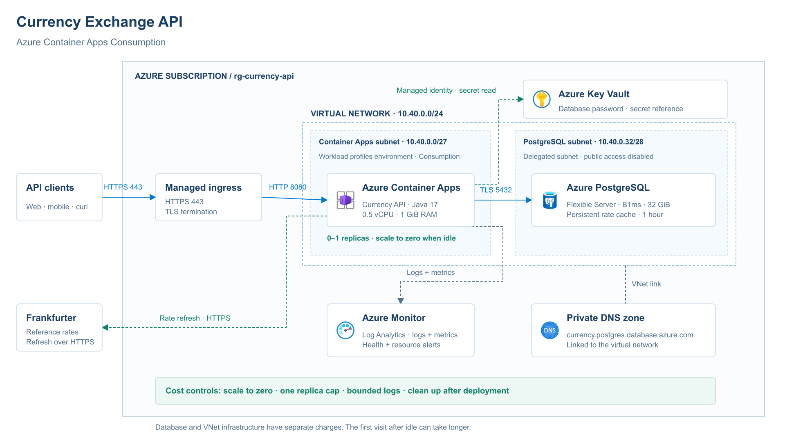
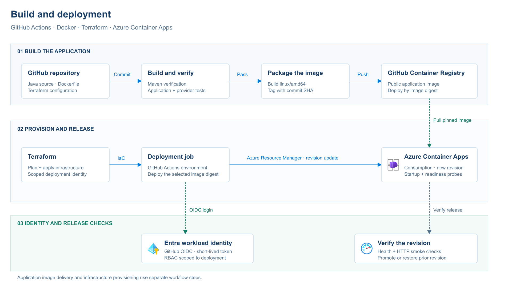

# Azure hosting architecture

[Project overview](../../README.md) · [Application design](../architecture.md) · [Editable draw.io file](Currency-API-Azure-Architecture.drawio)

I chose Azure Container Apps Consumption to run the existing Docker application with managed ingress and scale-to-zero. This page describes the Azure hosting design; the recorded execution results are in the [local verification report](../verification.md).

## Cloud architecture

[Open full-size architecture](01-cloud-architecture.png) · [SVG](01-cloud-architecture.svg)

Clients reach managed HTTPS ingress, which terminates TLS and forwards requests to the API on port 8080. The application starts with a 0.5 vCPU / 1 GiB allocation and a zero-to-one replica range. The private PostgreSQL connection uses TLS on port 5432. Frankfurter is contacted over HTTPS when the one-hour rate snapshot needs refreshing.

| Choice | Reason |
| --- | --- |
| Consumption workload profile. | Reuses the Docker application and scales its compute to zero between visits. |
| One replica cap initially. | Bounds compute usage and matches the application's current single-process cache refresh. |
| Separate application and database subnets. | Keeps the database private while exposing the API through managed ingress. |
| PostgreSQL B1ms with 32 GiB storage. | A small starting size for this light workload, with performance and CPU credits checked during deployment. |
| Private DNS zone linked to the VNet. | Resolves the database hostname to its private address. |
| Key Vault reference and managed identity. | Gives the API permission to read its database secret without embedding the password in its image. |
| Azure Monitor and Log Analytics. | Collects container logs and platform metrics for troubleshooting and alerting. |

The subnet layout uses `10.40.0.0/27` for the Container Apps environment and `10.40.0.32/28` for PostgreSQL, inside `10.40.0.0/24`. These are address allocations for this project, rather than a connection to the RestSim networks. The Key Vault connection uses HTTPS and identity-based access; it is separate from PostgreSQL's private network path.

Scaling the API to zero does not stop PostgreSQL or VNet infrastructure charges. A custom VNet can add platform-managed load-balancer and public-IP charges. The first request after idle can take longer while the API starts. The deployment cost estimate will include these components before resources are provisioned.

## Build and deployment

[Open full-size delivery flow](02-build-deployment.png) · [SVG](02-build-deployment.svg)

The delivery design verifies the application, builds a Linux AMD64 image, publishes it to GitHub Container Registry and deploys a pinned image digest to Container Apps. Terraform provisioning and application releases use separate workflow steps. GitHub OIDC supplies short-lived Azure access through an identity scoped to deployment.

The new revision is checked with startup/readiness probes and HTTP smoke requests. The previous working image and revision provide the rollback reference. A public application image avoids a paid registry baseline; database credentials stay outside the image.

The `.drawio` file contains both pages as editable shapes and connectors. Azure service icons come from Microsoft's Azure Architecture Center icon collection.
